# SkillTrack

A training center manager for computer training centers and coaching centers, as an Android app and a web app that share the same records. Admissions, fees and money receipts, dues with WhatsApp reminders, attendance, exams and results, certificates and ID cards, enquiries, expenses, instructor pay and profit reports.

The owner creates the center and adds staff by their Google email. Everyone works on the same records from their own phone or browser, each with what their role allows. Any number of centers can use it; each center sees only its own records.

**[Download the latest APK](https://github.com/ocpabdurrahim/skilltrack/releases/latest)** (Android 8.0 or newer) · **[Open the web app](https://skilltrack-058fd.web.app)**

| Home | Student | Batch |
|---|---|---|
| 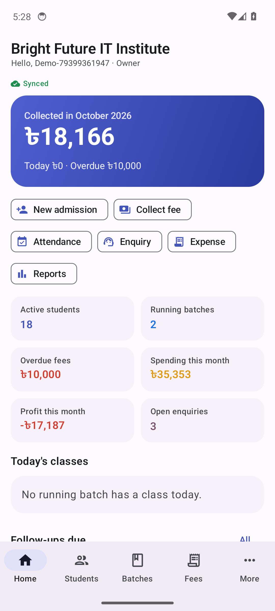 | 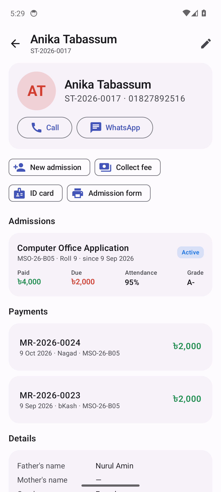 | 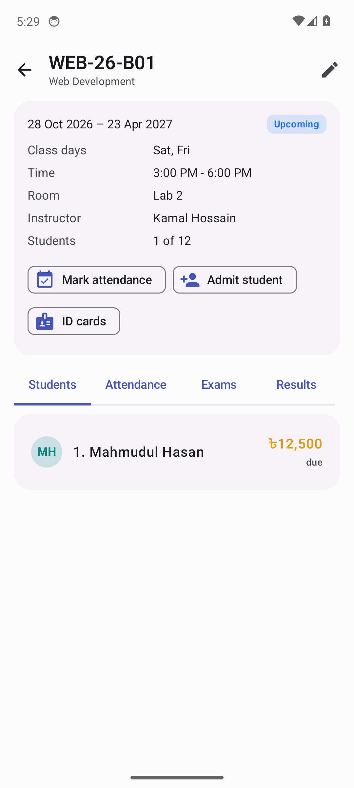 |
| **Attendance** | **Results** | **Money receipt** |
| 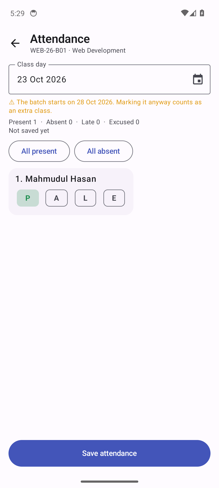 | 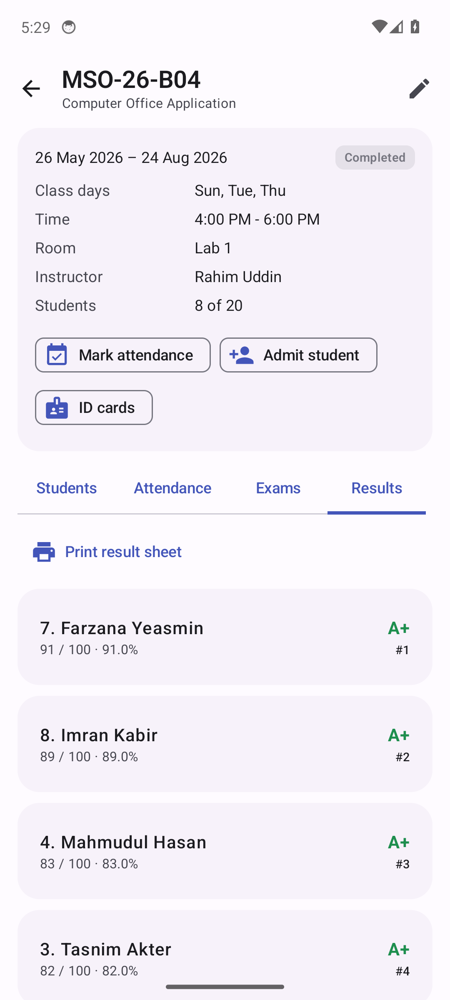 | 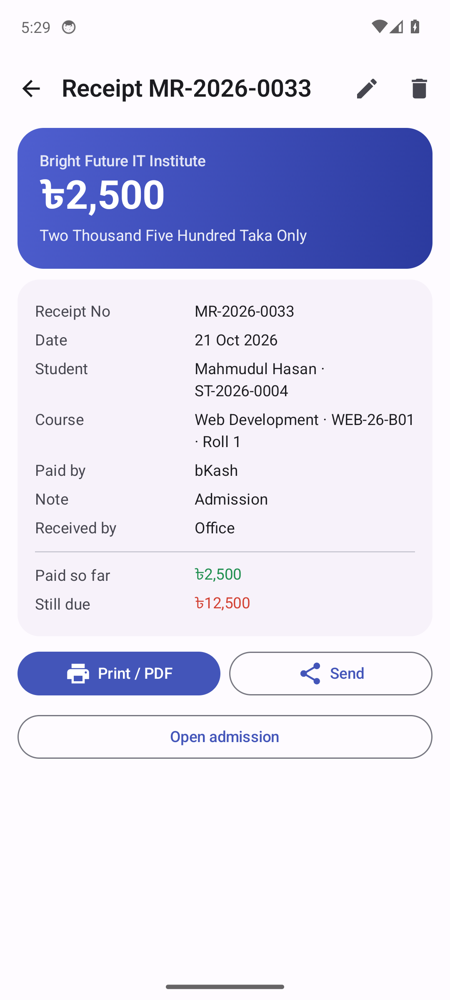 |
| **Dues** | **Reports** | **Dark theme** |
| 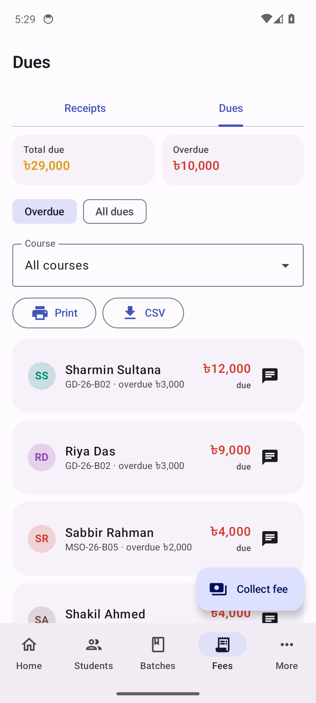 | 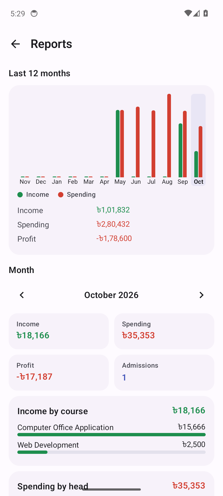 | 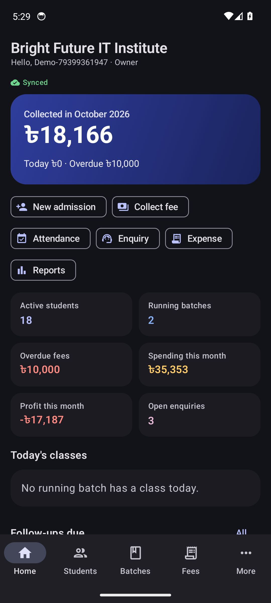 |

On the web:

| Batch results | Printable receipt |
|---|---|
| 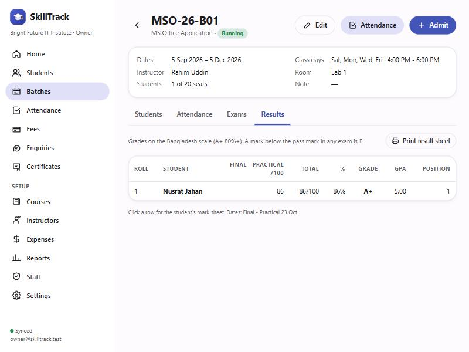 | 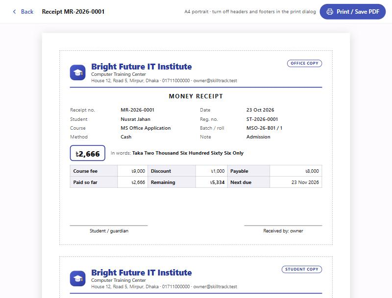 |

*The phone screenshots are taken automatically by CI on an Android 14 emulator, using sample data.*

## Features

- **Students:** a profile with photo, parents, phone, education and NID or birth registration number. Student IDs (`ST-2026-0001`) are given automatically. Search by name, ID or phone. Export to CSV.
- **Admissions:** put a student in a batch with the course fee, a discount and a payment plan (pay in full, or 2/3/4/6 monthly installments you can edit). Collect the first payment on the spot. Turn an enquiry into an admission in one tap.
- **Fees:**
  - money receipts (`MR-2026-0001`) with the amount in words, printed as an office copy and a student copy on one A4 page, or saved as PDF;
  - paid / due / overdue for every admission, worked out from its plan;
  - a dues list with WhatsApp and SMS reminders;
  - daily and monthly collection, broken down by payment method (cash, bKash, Nagad, Rocket, bank, card).
- **Courses and batches:** class days (Sat–Fri), time, room, seats and instructor. Status (upcoming, running, completed) follows the batch's dates.
- **Attendance:** Present, Absent, Late or Excused for each class with one tap per student. Warnings for days that are not class days. Attendance rate per student, and a list of who is below 75%.
- **Exams and results:** any number of exams per batch with full and pass marks, and marks entry for the whole batch. Results use the Bangladesh grading scale (A+ … F, GPA) with positions in the batch. Printable result sheets and mark sheets.
- **Certificates and ID cards:** issue certificates (`CERT-2026-0001`) to students who completed a course and keep them in a register. Prints an A4 landscape certificate and CR80-size student ID cards with photos.
- **Enquiries:** walk-ins and calls with their source, follow-up dates and conversion rate.
- **Expenses and profit:** expenses by head (rent, bills, internet, salaries…), instructor pay, and income against spending and profit for each month and the last 12 months.
- **Instructors:** paid monthly, per batch, per class or not at all. Shows what they earned, what they were paid and what is still owed.
- **Staff and roles:**

  | Role | Can do |
  |---|---|
  | Owner | Everything, including staff and center settings |
  | Admin | Everything except the owner's own record |
  | Office | Students, admissions, fees, enquiries, expenses, certificates |
  | Teacher | Attendance and exam marks; sees no money at all |

  The server enforces these roles, not only the apps.
- **Your center's own look:** the center's name, logo, address and phone appear on every printout. You can choose the currency, the digit grouping (12,34,567) and the number prefixes.
- **Works offline:** the phone keeps a copy of the center. Changes made without internet are sent when it comes back, and other staff see them within seconds.
- Android extras: an app lock (PIN with fingerprint or face), light and dark themes, and automatic updates from this repository's releases.

## How it is built

| Part | What |
|---|---|
| Android | Kotlin, Jetpack Compose, Material 3; Cloud Firestore with an unlimited offline cache; Google sign-in through Credential Manager |
| Web | React, TypeScript, Vite; Firestore with a persistent browser cache; Firebase Hosting |
| Server | Cloud Firestore and Firebase Auth. `firestore.rules` gives each center's staff access by role |
| Printing | HTML print layouts: Android's print service on the phone (which can also save as PDF), the browser's print on the web |

Both apps follow one written contract, [docs/data-model.md](docs/data-model.md). It covers where every record lives and the rules both apps compute the same way: dues and overdue amounts, attendance rates, grades and positions, instructor pay and profit.

```
app/src/main/java/io/github/ocpabdurrahim/skilltrack/
├── data/      record types, the Firestore-backed center store, sign-in and centers
├── domain/    money, dates, fees, attendance, results, instructor pay, amounts in words
├── print/     receipts, certificates, ID cards, result sheets, dues lists (HTML)
├── system/    photos, sharing (WhatsApp/SMS/CSV), Google sign-in, biometrics
├── update/    self-update from GitHub releases
└── ui/        Compose screens
web/src/       the web app (same data model and rules)
web/rules/     tests for firestore.rules, run against the Firestore emulator
```

## Building

GitHub Actions builds every push:

- [`build.yml`](.github/workflows/build.yml), the Android app:
  1. unit tests, plus the debug and release APKs;
  2. a run on an Android 14 emulator against local Firebase emulators: UI and role tests, a screenshot tour, the self-update test and a smoke test of the minified release APK;
  3. on `main`, when `appVersionName` is newer than the latest release and everything above passed: the release publishes itself (tag `vX.Y.Z` plus the signed APK).
- [`web.yml`](.github/workflows/web.yml), the web app: type-check, unit tests, security-rules tests against the Firestore emulator, and a production build.

Installed phones update themselves from the latest release. They check `releases/latest` at start-up (at most every 6 hours) and once a day, verify the APK's SHA-256, package name, `versionCode` and signing certificate, and install it once the app is in the background.

**To ship a new version:** raise `appVersionName` in `app/build.gradle.kts` (for example `1.0.1` → `1.0.2`), put what changed in `docs/release-notes.md`, and push to `main`. Nothing else is needed: the version code follows from the name (1.2.3 → 10203), CI tests the build and publishes the release, and phones pick it up. A version that is not newer than the latest release is never published.

Locally:

```bash
npm --prefix web install
```

```bash
npm --prefix web run build
```

```bash
npx firebase-tools deploy --only hosting,firestore
```

The Android build needs `app/google-services.json`, which is not in the repository. CI writes it from the `FIREBASE_GOOGLE_SERVICES` secret. Without that secret it uses `app/google-services.demo.json`, which works only with the Firebase emulators. To work on the web app against the emulators, run:

```bash
npx firebase-tools emulators:start --only auth,firestore --project demo-skilltrack
```

and then:

```bash
npm --prefix web run dev:emulator
```

Release builds are signed with the key from the `SKILL_KEYSTORE_*` repository secrets.

## Data and privacy

A center's records are stored in this project's Cloud Firestore database. Only that center's active staff can read them, and the security rules decide what each role may change. Nothing is ever hard-deleted: a deleted record is kept as a marker, so every device learns about the deletion. Theme, app lock and update settings stay on each phone.
